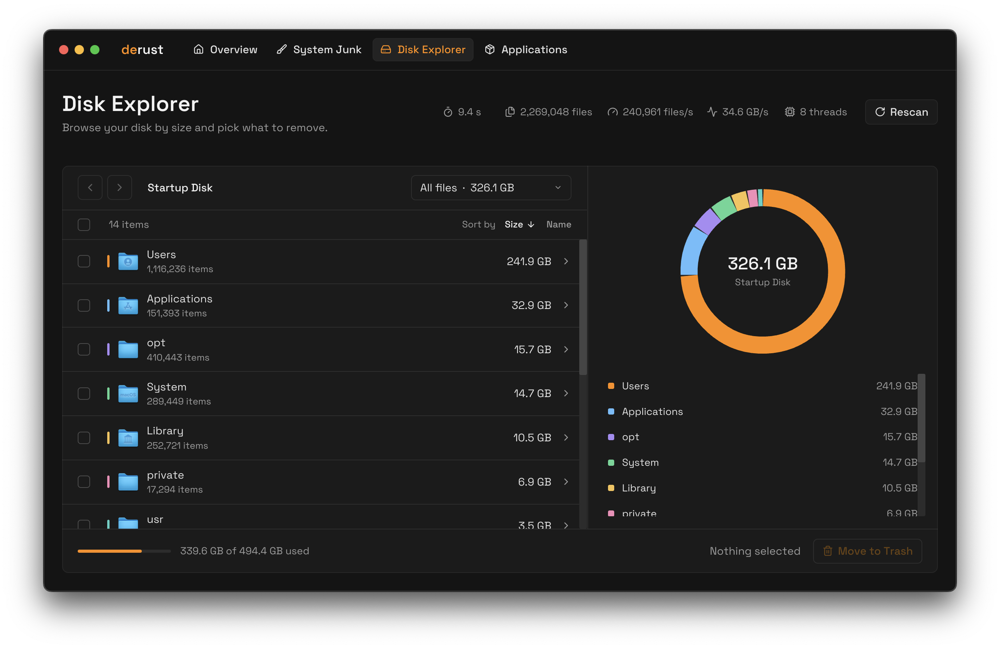

# derust

A fast, free and open source alternative to CleanMyMac, written in Rust.



## Features

- **System Junk**: caches, logs, Xcode leftovers and broken launch agents
- **Disk Explorer**: browse your whole disk by size and remove what you don't need
- **Applications**: uninstall apps together with their leftover files

Everything goes to the Trash, so nothing is lost by accident.

## Performance

Scans use `getattrlistbulk` and run in parallel on the performance cores. A full disk with about 2.3 million files takes around 10 seconds on an M4 Pro.

The release binary is about **7.5 MB**.

## Building

```sh
cargo build --release
./target/release/derust
```

Grant Full Disk Access in System Settings for complete results.

## License

MIT
